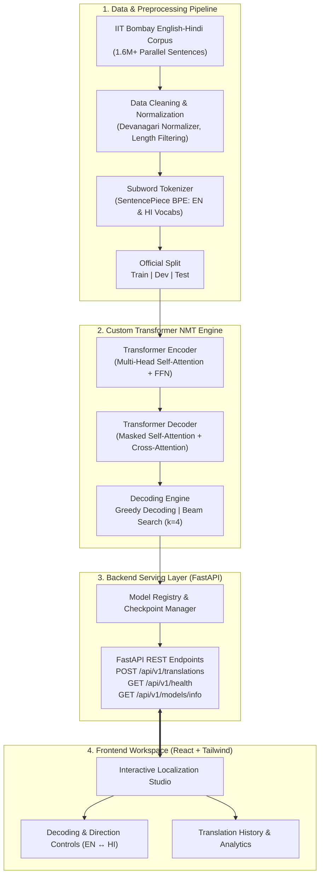

# Neural Machine Translation & Localization Platform

<div align="center">

[](https://www.python.org/)
[](https://pytorch.org/)
[](https://fastapi.tiangolo.com/)
[](https://reactjs.org/)
[](https://tailwindcss.com/)
[](https://opensource.org/licenses/MIT)
[](https://www.cfilt.iitb.ac.in/iitb_parallel/)
[](#core-transformer-architecture)
[](experiments/train_kaggle.ipynb)

**An End-to-End Generative AI Translation & Localization Platform for English ↔ Hindi**  
*Grounded in "Attention Is All You Need" (NeurIPS 2017) • Trained on the Official IIT Bombay Parallel Corpus*

</div>

---

## 📌 Table of Contents

- [1. Executive Summary](#1-executive-summary)
- [2. Key Capabilities & Highlights](#2-key-capabilities--highlights)
- [3. End-to-End System Architecture](#3-end-to-end-system-architecture)
- [4. Core Transformer Architecture](#4-core-transformer-architecture)
- [5. Dataset & Preprocessing Pipeline](#5-dataset--preprocessing-pipeline)
- [6. Decoding Strategies (Greedy vs. Beam Search)](#6-decoding-strategies-greedy-vs-beam-search)
- [7. Evaluation Metrics & Benchmark Targets](#7-evaluation-metrics--benchmark-targets)
- [8. Repository Structure](#8-repository-structure)
- [9. Quickstart & Installation](#9-quickstart--installation)
  - [Prerequisites](#prerequisites)
  - [Data, training & evaluation](#2-data-1-minute-after-download)
  - [Run the application](#5-run-the-application)
- [10. API Specifications](#10-api-specifications)
- [11. 12-Week Project Roadmap](#11-12-week-project-roadmap)
- [12. Architecture Decision Records (ADRs)](#12-architecture-decision-records-adrs)
- [13. License & Acknowledgements](#13-license--acknowledgements)

---

## 1. Executive Summary

The **Neural Machine Translation & Localization Platform** is a full-stack Generative AI system engineered to perform bidirectional **English ↔ Hindi** sequence-to-sequence translation.

Unlike wrapper projects that simply call commercial translation APIs (e.g., Google Translate or OpenAI), this project designs, implements, trains, tunes, evaluates, and deploys a **from-scratch PyTorch Transformer Encoder-Decoder**. The model is trained on the official **IIT Bombay English-Hindi Parallel Corpus** and strictly evaluated against the isolated official test split.

The machine learning core is packaged alongside a high-throughput **FastAPI** asynchronous inference engine and served to an interactive **React + Tailwind CSS** localization workspace equipped with translation memory, decoding strategy tuners, and live evaluation analytics.

---

## 2. Key Capabilities & Highlights

- **Custom Generative Architecture**: Complete PyTorch implementation of Multi-Head Self-Attention, Cross-Attention, Sinusoidal Positional Encoding, and Feedforward Networks with residual normalization.
- **True Bidirectional NMT**: Dedicated model pipelines supporting both English → Hindi and Hindi → English.
- **Language-Aware Tokenization**: Subword segmentation via SentencePiece / Byte-Pair Encoding (BPE) handling complex Devanagari conjuncts, matras, and inflectional morphologies.
- **Advanced Decoding Strategies**: Dual decoding runtime offering deterministic **Greedy Search** for high throughput and **Beam Search with Length Normalization** for optimal translation fidelity.
- **Rigorous Evaluation Framework**: Objective tracking of **SacreBLEU** and **chrF++** scores benchmarked across training checkpoints.
- **Production REST API**: FastAPI server with automated schema validation, `/health` and `/ready` probes, structured error envelopes, and model metadata registration.
- **Modern Localization UI**: Interactive dual-pane editor featuring real-time translation generation, parameter controls (temperature, beam size, length penalty), and user translation history.

---

## 3. End-to-End System Architecture



---

## 4. Core Transformer Architecture

The underlying translation engine follows the canonical encoder-decoder Transformer architecture:

$$\text{Attention}(Q, K, V) = \text{softmax}\left(\frac{QK^T}{\sqrt{d_k}}\right)V$$

$$\text{MultiHead}(Q, K, V) = \text{Concat}(\text{head}_1, \dots, \text{head}_h)W^O$$

$$\text{where} \quad \text{head}_i = \text{Attention}(QW_i^Q, KW_i^K, VW_i^V)$$

```
Source Sequence (e.g. English)         Target Sequence (e.g. Hindi - shifted right)
             │                                              │
     Input Embedding                                Target Embedding
             │                                              │
   + Positional Encoding                          + Positional Encoding
             │                                              │
  ┌───────────────────────┐                      ┌───────────────────────┐
  │ Multi-Head Attention  │                      │ Masked Attention      │
  │ (Self-Attention)      │                      │ (Causal Lookahead)    │
  └──────────┬────────────┘                      └──────────┬────────────┘
             │                                              │
  ┌───────────────────────┐                      ┌───────────────────────┐
  │ Add & LayerNorm       │                      │ Add & LayerNorm       │
  └──────────┬────────────┘                      └──────────┬────────────┘
             │                                              │
  ┌───────────────────────┐                      ┌───────────────────────┐
  │ Feed Forward Network  │                      │ Multi-Head Attention  │
  └──────────┬────────────┘                      │ (Cross-Attention)◄────┼─── Encoder Output
             │                                   └──────────┬────────────┘
  ┌───────────────────────┐                                 │
  │ Add & LayerNorm       │                      ┌───────────────────────┐
  └──────────┬────────────┘                      │ Add & LayerNorm       │
             │                                   └──────────┬────────────┘
        (N=6 Layers)                                        │
             │                                   ┌───────────────────────┐
             └──────────────────────────────────►│ Feed Forward Network  │
                                                 └──────────┬────────────┘
                                                            │
                                                 ┌───────────────────────┐
                                                 │ Linear + Softmax      │
                                                 └──────────┬────────────┘
                                                            │
                                                    Predicted Subwords
```

### Key Architectural Specifications:
- **Embedding Dimension ($d_{\text{model}}$)**: 512 (Baseline: 256 for rapid iteration)
- **Feed-Forward Dimension ($d_{ff}$)**: 2048 (Baseline: 1024)
- **Attention Heads ($h$)**: 8
- **Encoder / Decoder Layers ($N$)**: 6 layers
- **Dropout Rate**: 0.1
- **Positional Encoding**: Fixed Sinusoidal ($PE_{(pos, 2i)} = \sin(pos / 10000^{2i/d_{model}})$)
- **Label Smoothing**: $\epsilon = 0.1$ for cross-entropy regularization

---

## 5. Dataset & Preprocessing Pipeline

The model is trained on the [IIT Bombay English-Hindi Parallel Corpus](https://www.cfilt.iitb.ac.in/iitb_parallel/):
- **Raw Sentences**: ~1.6 million aligned parallel sentence pairs.
- **Official Splits**:
  - `train`: ~1,561,840 sentence pairs.
  - `dev`: 520 sentence pairs (hyperparameter tuning).
  - `test`: 2,507 sentence pairs (isolated benchmark evaluation).

### Preprocessing Protocol:
1. **Unicode & Devanagari Normalization**: Normalization with unicodedata (NFKC) and nukta/chandrabindu consolidation.
2. **Noise Reduction**: Removal of HTML tags, control characters, empty pairs, and identical source/target pairs.
3. **Length Constraints**: Filtering sentences where tokens $> 128$ or length ratio exceeds $1:2.5$.
4. **Vocabulary & Subwords**: Unigram / BPE tokenization trained with target vocabulary sizes of 16,000 to 32,000 subwords per language.

---

## 6. Decoding Strategies (Greedy vs. Beam Search)

The inference runtime implements two distinct decoding mechanisms:

| Feature | Greedy Decoding | Beam Search Decoding |
| :--- | :--- | :--- |
| **Selection Rule** | $y_t = \arg\max_w P(w \mid y_{<t}, X)$ | Explores top-$k$ hypotheses simultaneously |
| **Computational Cost** | $\mathcal{O}(T \cdot V)$ | $\mathcal{O}(k \cdot T \cdot V)$ |
| **Beam Size ($k$)** | $k=1$ | Configurable ($k=4$ recommended) |
| **Length Penalty** | N/A | $\text{score}(Y) = \frac{\log P(Y)}{((5 + |Y|) / 6)^\alpha}$ |
| **Best Use Case** | High-throughput realtime preview | Final localization & benchmark evaluation |

---

## 7. Evaluation Metrics & Benchmark Targets

To reflect holistic translation quality, evaluation uses both n-gram precision (**SacreBLEU**) and character n-gram F-score (**chrF++**), which is especially vital for morphologically rich languages like Hindi.

| Metric | Translation Direction | Minimum Acceptable Target | Stretch Engineering Target |
| :--- | :--- | :--- | :--- |
| **BLEU** | English → Hindi | $\ge 20.0$ | $\ge 25.0$ |
| **chrF++** | English → Hindi | $\ge 45.0$ | $\ge 50.0$ |
| **BLEU** | Hindi → English | $\ge 22.0$ | $\ge 28.0$ |
| **chrF++** | Hindi → English | $\ge 50.0$ | $\ge 55.0$ |
| **Baseline → Final Gain** | Both Directions | $\ge 10\%$ Relative Gain | $\ge 15\%$ Relative Gain |

---

## 8. Repository Structure

```
Neural-Machine-Translation-System/
├── docs/                          PRD + complete project documentation
├── ml/                            Machine-learning core (PyTorch, no pre-trained models)
│   ├── transformer/               embedding.py, attention.py, encoder.py, decoder.py, model.py
│   ├── tokenization/tokenizer.py  SentencePiece BPE wrapper (+ trained spm_en/spm_hi.model)
│   ├── data/                      preprocess.py (normalization/filters), dataset.py (token-bucket batching)
│   ├── training/trainer.py        warmup + inverse-sqrt LR, AMP, accumulation, checkpoint/resume
│   ├── decoding/strategy.py       batched greedy + beam search (length penalty)
│   ├── inference/                 translator.py (text in/out), loader.py (checkpoint + tokenizer checks)
│   ├── evaluation/evaluator.py    sacreBLEU BLEU + chrF++ with signatures
│   └── configs/                   baseline_config.yaml (small, laptop), transformer_base.yaml (Kaggle)
├── scripts/
│   ├── prepare_data.py            download IITB, clean, dedupe, leakage check, train tokenizers
│   ├── train.py                   train one direction (--direction en-hi | hi-en), resumable
│   ├── evaluate.py                BLEU/chrF++ on the official test split -> eval_*.json
│   ├── make_report.py             experiments/evaluation_report.md (comparisons + error analysis)
│   ├── training_status.py         progress of every run; prints DONE when training has finished
│   ├── train_baseline_local.ps1   train + evaluate both directions on a local GPU (Windows)
│   └── make_kaggle_bundle.py      zip the code for a Kaggle dataset
├── experiments/train_kaggle.ipynb Kaggle notebook: Transformer-base, both directions on T4 x2
├── models/<run>/                  best.pt, last.pt, metrics.json, config.yaml, tokenizers, eval reports
├── backend/app/                   FastAPI: auth (JWT), SQLite history, models, evaluations, health
└── frontend/src/                  React + Tailwind + Axios: login, translate, history, evaluation dashboard
```

---

## 9. Quickstart & Installation

### Prerequisites
Python 3.10+ (3.11 tested), Node.js 18+, optionally an NVIDIA GPU with CUDA.

### 1. Python environment
```bash
python -m venv .venv
# Windows: .venv\Scripts\activate      Linux/macOS: source .venv/bin/activate
pip install torch --index-url https://download.pytorch.org/whl/cu124   # or the CPU wheel
pip install -r requirements.txt
cp .env.example .env        # then set SECRET_KEY (see the comment in the file)
```

### 2. Data (≈1 minute after download)
```bash
python scripts/prepare_data.py            # full corpus, 16k BPE per language
```
Result on the official split: 1,659,083 raw training pairs → 62,795 removed by filters,
229,200 duplicates removed, 0 overlapping with dev/test → **1,367,088 training pairs**;
dev 520, test 2,507 (unchanged). Details: `data/processed/data_report.json`.

### 3. Train
```bash
# Small baseline (15.6M params) on a local GPU, both directions + evaluation:
powershell -ExecutionPolicy Bypass -File scripts\train_baseline_local.ps1     # Windows
# or one direction on any OS:
python scripts/train.py --config ml/configs/baseline_config.yaml --direction en-hi --resume auto
```
* `--resume auto` continues from `models/<run>/last.pt` (mid-epoch); `--max_hours N` stops cleanly.
* `best.pt` is selected by **dev BLEU**; the test set is never used for training decisions.
* Full-size model: open `experiments/train_kaggle.ipynb` on Kaggle (GPU T4 x2) — it trains
  both directions in parallel and resumes across 12-hour sessions (instructions inside).

### 4. Evaluate and report
```bash
python scripts/evaluate.py --checkpoint models/transformer_small_en-hi/best.pt --strategy beam_search
python scripts/make_report.py             # -> experiments/evaluation_report.md
```

### 5. Run the application
```bash
uvicorn backend.app.main:app --port 8000          # API + Swagger at http://localhost:8000/docs
cd frontend && npm install && npm run dev         # UI at http://localhost:5173
```
Create an account on the login screen, then translate. Use `DEVICE=cpu` in `.env` while a
training job is using the GPU.

### 6. Tests
```bash
pytest tests/ -q        # 28 tests: model, training pipeline, decoding, API, auth, history isolation
```

### 7. Deploy (free: Render + Hugging Face model repo)
* **Models** live in a free Hugging Face model repo (`yadavlakshya743/nmt-en-hi-models`). Publish the
  newest checkpoints at any time (safe while training): `python scripts/publish_models.py --repo yadavlakshya743/nmt-en-hi-models`.
  For each direction the run with the best dev BLEU is served.
* **App**: `render.yaml` defines a free Render web service built from `deploy/Dockerfile.web`
  (React + FastAPI in one container). On render.com: *New → Blueprint →* select this repo.
  Every push to `main` redeploys; a restart/redeploy also downloads the newest published models.
* Free-tier limits: 512 MB RAM, shared CPU (translations take seconds), sleeps after 15 min idle
  (~1 min to wake), and no persistent disk (accounts/history reset on restart).

---

## 10. API Specifications

Base URL `/api/v1`. Errors always use one envelope:
`{"error": {"code": "...", "message": "...", "request_id": "req_..."}}` (no stack traces).

| Method | Endpoint | Auth | Description |
| :--- | :--- | :---: | :--- |
| `POST` | `/auth/register` | – | Create an account (username, password ≥ 8 chars) |
| `POST` | `/auth/login` | – | Returns a JWT bearer token |
| `POST` | `/auth/logout` | ✓ | Client discards the token (stateless JWT) |
| `GET` | `/auth/me` | ✓ | Current user |
| `POST` | `/translations` | ✓ | Translate EN↔HI; saved to the caller's history |
| `GET` | `/translations?limit&offset` | ✓ | Caller's own history (newest first) |
| `GET` | `/translations/{id}` | ✓ | One record — 404 if it belongs to another user |
| `GET` | `/models/active` | – | Loaded model per direction: run, size, tokenizer sha256, best dev BLEU |
| `GET` | `/evaluations` | – | Training curves, dev/test BLEU & chrF++, examples, data report |
| `GET` | `/health` | – | Liveness (process up) |
| `GET` | `/ready` | – | Readiness: 200 only when a trained model is loaded, else 503 |

Error codes: `UNAUTHORIZED`, `INVALID_CREDENTIALS`, `USERNAME_TAKEN`, `VALIDATION_ERROR`,
`INVALID_LANGUAGE_DIRECTION`, `MODEL_NOT_AVAILABLE` (503), `INFERENCE_FAILED`, `NOT_FOUND`.

```json
POST /api/v1/translations        Authorization: Bearer <token>
{"source_text": "I am going to college.", "source_lang": "en", "target_lang": "hi",
 "decoding_strategy": "beam_search", "beam_size": 4, "length_penalty": 0.6, "max_length": 128}

200 OK
{"request_id": "req_21a55553ff71", "translated_text": "मैं कॉलेज जा रहा हूँ।",
 "source_lang": "en", "target_lang": "hi", "model_version": "transformer_small_en-hi",
 "decoding_strategy": "beam_search", "beam_size": 4, "latency_ms": 74.1,
 "tokens_generated": 9, "created_at": "2026-11-27T12:27:40+00:00"}
```

---

## 11. 12-Week Project Roadmap

| Phase | Weeks | Focus & Deliverables |
| :---: | :---: | :--- |
| **Phase 1** | Week 1–2 | Literature review (Attention Is All You Need), PRD & architecture specifications. |
| **Phase 2** | Week 3–4 | Corpus acquisition (IIT Bombay), cleaning, Devanagari normalizer, BPE tokenization. |
| **Phase 3** | Week 5–6 | Custom PyTorch Transformer implementation (Attention, Encoder, Decoder, Masks). |
| **Phase 4** | Week 7–8 | Training loop, checkpointing, validation loss tracking, SacreBLEU & chrF++ evaluation. |
| **Phase 5** | Week 9–10 | Advanced decoding (Beam Search), FastAPI serving layer, model registry. |
| **Phase 6** | Week 11–12 | React localization workspace, end-to-end integration, performance profiling & final defense. |

---

## 12. Architecture Decision Records (ADRs)

- **[ADR-001] Custom Transformer vs. External APIs**: Selected a custom PyTorch encoder-decoder to demonstrate deep ML engineering and sequence modeling depth.
- **[ADR-002] FastAPI for Model Serving**: Leverages asynchronous Python execution, native Pydantic validation, and minimal overhead for PyTorch tensor operations.
- **[ADR-003] Dual Evaluation (BLEU + chrF++)**: Combined BLEU for word precision and chrF++ for character-level morphology handling in Hindi.
- **[ADR-004] Strategy Pattern for Decoding**: Encapsulated Greedy and Beam Search inside modular classes to facilitate rapid decoding experimentation.

---

## 13. License & Acknowledgements

- **License**: Distributed under the [MIT License](LICENSE).
- **Corpus**: IIT Bombay English-Hindi Parallel Corpus provided by the Center for Indian Language Technology (CFILT), IIT Bombay.
- **Foundation Research**: Vaswani et al., *"Attention Is All You Need"*, NeurIPS 2017.
- **Author**: **Lakshya Yadav** ([@yadavlakshya743](https://github.com/yadavlakshya743))
