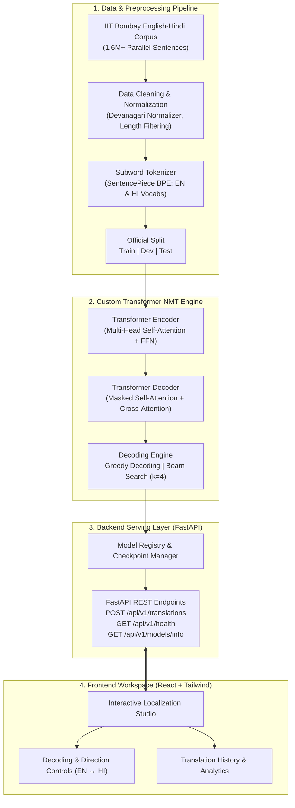

# Neural Machine Translation & Localization Platform

<div align="center">

[](https://www.python.org/)
[](https://pytorch.org/)
[](https://fastapi.tiangolo.com/)
[](https://reactjs.org/)
[](https://tailwindcss.com/)
[](https://opensource.org/licenses/MIT)
[](https://www.cfilt.iitb.ac.in/iitb_parallel/)
[](#core-transformer-architecture)
[](https://colab.research.google.com/github/yadavlakshya743/Neural-Machine-Translation-System/blob/main/experiments/train_colab.ipynb)

**An End-to-End Generative AI Translation & Localization Platform for English ↔ Hindi**  
*Grounded in "Attention Is All You Need" (NeurIPS 2017) • Trained on the Official IIT Bombay Parallel Corpus*

</div>

---

## 📌 Table of Contents

- [1. Executive Summary](#1-executive-summary)
- [2. Key Capabilities & Highlights](#2-key-capabilities--highlights)
- [3. End-to-End System Architecture](#3-end-to-end-system-architecture)
- [4. Core Transformer Architecture](#4-core-transformer-architecture)
- [5. Dataset & Preprocessing Pipeline](#5-dataset--preprocessing-pipeline)
- [6. Decoding Strategies (Greedy vs. Beam Search)](#6-decoding-strategies-greedy-vs-beam-search)
- [7. Evaluation Metrics & Benchmark Targets](#7-evaluation-metrics--benchmark-targets)
- [8. Repository Structure](#8-repository-structure)
- [9. Quickstart & Installation](#9-quickstart--installation)
  - [Prerequisites](#prerequisites)
  - [Backend & ML Setup](#backend--ml-setup)
  - [Frontend Workspace Setup](#frontend-workspace-setup)
- [10. API Specifications](#10-api-specifications)
- [11. 12-Week Project Roadmap](#11-12-week-project-roadmap)
- [12. Architecture Decision Records (ADRs)](#12-architecture-decision-records-adrs)
- [13. License & Acknowledgements](#13-license--acknowledgements)

---

## 1. Executive Summary

The **Neural Machine Translation & Localization Platform** is a full-stack Generative AI system engineered to perform bidirectional **English ↔ Hindi** sequence-to-sequence translation.

Unlike wrapper projects that simply call commercial translation APIs (e.g., Google Translate or OpenAI), this project designs, implements, trains, tunes, evaluates, and deploys a **from-scratch PyTorch Transformer Encoder-Decoder**. The model is trained on the official **IIT Bombay English-Hindi Parallel Corpus** and strictly evaluated against the isolated official test split.

The machine learning core is packaged alongside a high-throughput **FastAPI** asynchronous inference engine and served to an interactive **React + Tailwind CSS** localization workspace equipped with translation memory, decoding strategy tuners, and live evaluation analytics.

---

## 2. Key Capabilities & Highlights

- **Custom Generative Architecture**: Complete PyTorch implementation of Multi-Head Self-Attention, Cross-Attention, Sinusoidal Positional Encoding, and Feedforward Networks with residual normalization.
- **True Bidirectional NMT**: Dedicated model pipelines supporting both English → Hindi and Hindi → English.
- **Language-Aware Tokenization**: Subword segmentation via SentencePiece / Byte-Pair Encoding (BPE) handling complex Devanagari conjuncts, matras, and inflectional morphologies.
- **Advanced Decoding Strategies**: Dual decoding runtime offering deterministic **Greedy Search** for high throughput and **Beam Search with Length Normalization** for optimal translation fidelity.
- **Rigorous Evaluation Framework**: Objective tracking of **SacreBLEU** and **chrF++** scores benchmarked across training checkpoints.
- **Production REST API**: FastAPI server with automated schema validation, `/health` and `/ready` probes, structured error envelopes, and model metadata registration.
- **Modern Localization UI**: Interactive dual-pane editor featuring real-time translation generation, parameter controls (temperature, beam size, length penalty), and user translation history.

---

## 3. End-to-End System Architecture



---

## 4. Core Transformer Architecture

The underlying translation engine follows the canonical encoder-decoder Transformer architecture:

$$\text{Attention}(Q, K, V) = \text{softmax}\left(\frac{QK^T}{\sqrt{d_k}}\right)V$$

$$\text{MultiHead}(Q, K, V) = \text{Concat}(\text{head}_1, \dots, \text{head}_h)W^O$$

$$\text{where} \quad \text{head}_i = \text{Attention}(QW_i^Q, KW_i^K, VW_i^V)$$

```
Source Sequence (e.g. English)         Target Sequence (e.g. Hindi - shifted right)
             │                                              │
     Input Embedding                                Target Embedding
             │                                              │
   + Positional Encoding                          + Positional Encoding
             │                                              │
  ┌───────────────────────┐                      ┌───────────────────────┐
  │ Multi-Head Attention  │                      │ Masked Attention      │
  │ (Self-Attention)      │                      │ (Causal Lookahead)    │
  └──────────┬────────────┘                      └──────────┬────────────┘
             │                                              │
  ┌───────────────────────┐                      ┌───────────────────────┐
  │ Add & LayerNorm       │                      │ Add & LayerNorm       │
  └──────────┬────────────┘                      └──────────┬────────────┘
             │                                              │
  ┌───────────────────────┐                      ┌───────────────────────┐
  │ Feed Forward Network  │                      │ Multi-Head Attention  │
  └──────────┬────────────┘                      │ (Cross-Attention)◄────┼─── Encoder Output
             │                                   └──────────┬────────────┘
  ┌───────────────────────┐                                 │
  │ Add & LayerNorm       │                      ┌───────────────────────┐
  └──────────┬────────────┘                      │ Add & LayerNorm       │
             │                                   └──────────┬────────────┘
        (N=6 Layers)                                        │
             │                                   ┌───────────────────────┐
             └──────────────────────────────────►│ Feed Forward Network  │
                                                 └──────────┬────────────┘
                                                            │
                                                 ┌───────────────────────┐
                                                 │ Linear + Softmax      │
                                                 └──────────┬────────────┘
                                                            │
                                                    Predicted Subwords
```

### Key Architectural Specifications:
- **Embedding Dimension ($d_{\text{model}}$)**: 512 (Baseline: 256 for rapid iteration)
- **Feed-Forward Dimension ($d_{ff}$)**: 2048 (Baseline: 1024)
- **Attention Heads ($h$)**: 8
- **Encoder / Decoder Layers ($N$)**: 6 layers
- **Dropout Rate**: 0.1
- **Positional Encoding**: Fixed Sinusoidal ($PE_{(pos, 2i)} = \sin(pos / 10000^{2i/d_{model}})$)
- **Label Smoothing**: $\epsilon = 0.1$ for cross-entropy regularization

---

## 5. Dataset & Preprocessing Pipeline

The model is trained on the [IIT Bombay English-Hindi Parallel Corpus](https://www.cfilt.iitb.ac.in/iitb_parallel/):
- **Raw Sentences**: ~1.6 million aligned parallel sentence pairs.
- **Official Splits**:
  - `train`: ~1,561,840 sentence pairs.
  - `dev`: 520 sentence pairs (hyperparameter tuning).
  - `test`: 2,507 sentence pairs (isolated benchmark evaluation).

### Preprocessing Protocol:
1. **Unicode & Devanagari Normalization**: Normalization with unicodedata (NFKC) and nukta/chandrabindu consolidation.
2. **Noise Reduction**: Removal of HTML tags, control characters, empty pairs, and identical source/target pairs.
3. **Length Constraints**: Filtering sentences where tokens $> 128$ or length ratio exceeds $1:2.5$.
4. **Vocabulary & Subwords**: Unigram / BPE tokenization trained with target vocabulary sizes of 16,000 to 32,000 subwords per language.

---

## 6. Decoding Strategies (Greedy vs. Beam Search)

The inference runtime implements two distinct decoding mechanisms:

| Feature | Greedy Decoding | Beam Search Decoding |
| :--- | :--- | :--- |
| **Selection Rule** | $y_t = \arg\max_w P(w \mid y_{<t}, X)$ | Explores top-$k$ hypotheses simultaneously |
| **Computational Cost** | $\mathcal{O}(T \cdot V)$ | $\mathcal{O}(k \cdot T \cdot V)$ |
| **Beam Size ($k$)** | $k=1$ | Configurable ($k=4$ recommended) |
| **Length Penalty** | N/A | $\text{score}(Y) = \frac{\log P(Y)}{((5 + |Y|) / 6)^\alpha}$ |
| **Best Use Case** | High-throughput realtime preview | Final localization & benchmark evaluation |

---

## 7. Evaluation Metrics & Benchmark Targets

To reflect holistic translation quality, evaluation uses both n-gram precision (**SacreBLEU**) and character n-gram F-score (**chrF++**), which is especially vital for morphologically rich languages like Hindi.

| Metric | Translation Direction | Minimum Acceptable Target | Stretch Engineering Target |
| :--- | :--- | :--- | :--- |
| **BLEU** | English → Hindi | $\ge 20.0$ | $\ge 25.0$ |
| **chrF++** | English → Hindi | $\ge 45.0$ | $\ge 50.0$ |
| **BLEU** | Hindi → English | $\ge 22.0$ | $\ge 28.0$ |
| **chrF++** | Hindi → English | $\ge 50.0$ | $\ge 55.0$ |
| **Baseline → Final Gain** | Both Directions | $\ge 10\%$ Relative Gain | $\ge 15\%$ Relative Gain |

---

## 8. Repository Structure

```
Neural-Machine-Translation-System/
├── README.md                      # Primary project documentation & architecture guide
├── pyproject.toml                 # Package definition & tool configs
├── requirements.txt               # Pinned Python dependencies
├── .env.example                   # Environment configuration template
├── .gitignore                     # Git exclusion rules
│
├── docs/                          # Comprehensive architectural specifications & PRD
│   ├── Neural_Machine_Translation_PRD.md
│   └── Neural_Machine_Translation_Complete_Project_Documentation.md
│
├── ml/                            # Machine Learning Core
│   ├── configs/                   # Experiment & baseline YAML configs
│   │   └── baseline_config.yaml
│   ├── data/                      # Dataset loaders, cleaning & batch collation
│   │   ├── dataset.py
│   │   └── preprocess.py
│   ├── tokenization/              # Subword tokenizer training & wrapper
│   │   └── tokenizer.py
│   ├── transformer/               # Modular PyTorch Transformer implementation
│   │   ├── attention.py           # Scaled dot-product & Multi-Head Attention
│   │   ├── embedding.py           # Token embeddings & sinusoidal positional encodings
│   │   ├── encoder.py             # Encoder layers & encoder stack
│   │   ├── decoder.py             # Masked decoder layers & cross-attention stack
│   │   └── model.py               # Complete Seq2Seq Transformer model
│   ├── decoding/                  # Decoding strategies
│   │   └── strategy.py            # Greedy Search & Beam Search implementations
│   ├── training/                  # Training pipeline & checkpoint manager
│   │   └── trainer.py
│   ├── inference/                 # High-level translation interface
│   │   └── translator.py
│   └── evaluation/                # SacreBLEU & chrF++ calculation pipelines
│       └── evaluator.py
│
├── backend/                       # FastAPI Serving Layer
│   └── app/
│       ├── main.py                # App entrypoint, lifespan & CORS
│       ├── core/
│       │   └── config.py          # Pydantic settings management
│       ├── schemas/
│       │   ├── translation.py     # Request/Response validation models
│       │   └── health.py          # System probe schemas
│       ├── services/
│       │   └── translation_service.py # Model orchestration service
│       └── api/
│           └── v1/
│               └── routes.py      # REST endpoints for translations, health & info
│
├── frontend/                      # React + Tailwind Localization Workspace
│   ├── package.json
│   ├── vite.config.js
│   ├── tailwind.config.js
│   ├── index.html
│   └── src/
│       ├── App.jsx                # Localization Studio UI
│       └── index.css              # Custom styling & utility classes
│
├── models/                        # Saved checkpoints (.pt) [Git-ignored]
├── experiments/                   # Experiment metrics & evaluation reports
└── tests/                         # Automated test suite
    ├── test_transformer.py        # Model tensor shape & attention tests
    └── test_api.py                # FastAPI endpoint integration tests
```

---

## 9. Quickstart & Installation

### Prerequisites
- **Operating System**: Linux / macOS / Windows WSL2
- **Python**: Version 3.10 or higher
- **Node.js**: Version 18 or higher (for frontend)
- **CUDA Toolkit** (Optional): CUDA 11.8 / 12.1 for GPU-accelerated training

### Backend & ML Setup

1. **Clone the repository**:
   ```bash
   git clone https://github.com/yadavlakshya743/Neural-Machine-Translation-System.git
   cd Neural-Machine-Translation-System
   ```

2. **Create and activate a virtual environment**:
   ```bash
   python3 -m venv .venv
   source .venv/bin/activate
   ```

3. **Install Python dependencies**:
   ```bash
   pip install --upgrade pip
   pip install -r requirements.txt
   ```

4. **Configure environment variables**:
   ```bash
   cp .env.example .env
   ```

5. **Run automated test suite**:
   ```bash
   pytest tests/ -v
   ```

6. **Launch FastAPI inference server**:
   ```bash
   uvicorn backend.app.main:app --host 0.0.0.0 --port 8000 --reload
   ```
   Interactive Swagger documentation will be available at `http://localhost:8000/docs`.

### Frontend Workspace Setup

1. **Navigate to the frontend directory**:
   ```bash
   cd frontend
   npm install
   ```

2. **Start the development server**:
   ```bash
   npm run dev
   ```
   The Localization Workspace will be accessible at `http://localhost:5173`.

---

## 10. API Specifications

### Key Endpoints

| Method | Endpoint | Description |
| :--- | :--- | :--- |
| `GET` | `/api/v1/health` | Service liveness probe |
| `GET` | `/api/v1/ready` | Model readiness and GPU availability probe |
| `GET` | `/api/v1/models/info` | Active model architecture, parameters, and metadata |
| `POST` | `/api/v1/translations` | Generate bidirectional English ↔ Hindi translation |
| `GET` | `/api/v1/history` | Retrieve user translation activity history |

#### Sample Translation Request:
```json
POST /api/v1/translations
Content-Type: application/json

{
  "source_text": "Machine learning enables computers to learn from data.",
  "source_lang": "en",
  "target_lang": "hi",
  "decoding_strategy": "beam_search",
  "beam_size": 4,
  "length_penalty": 0.6,
  "max_length": 128
}
```

#### Sample Translation Response:
```json
{
  "request_id": "req_88f219c8",
  "source_text": "Machine learning enables computers to learn from data.",
  "translated_text": "मशीन लर्निंग कंप्यूटर को डेटा से सीखने में सक्षम बनाता है।",
  "source_lang": "en",
  "target_lang": "hi",
  "model_version": "transformer-baseline-v1",
  "decoding_strategy": "beam_search",
  "latency_ms": 48.2,
  "tokens_generated": 14
}
```

---

## 11. 12-Week Project Roadmap

| Phase | Weeks | Focus & Deliverables |
| :---: | :---: | :--- |
| **Phase 1** | Week 1–2 | Literature review (Attention Is All You Need), PRD & architecture specifications. |
| **Phase 2** | Week 3–4 | Corpus acquisition (IIT Bombay), cleaning, Devanagari normalizer, BPE tokenization. |
| **Phase 3** | Week 5–6 | Custom PyTorch Transformer implementation (Attention, Encoder, Decoder, Masks). |
| **Phase 4** | Week 7–8 | Training loop, checkpointing, validation loss tracking, SacreBLEU & chrF++ evaluation. |
| **Phase 5** | Week 9–10 | Advanced decoding (Beam Search), FastAPI serving layer, model registry. |
| **Phase 6** | Week 11–12 | React localization workspace, end-to-end integration, performance profiling & final defense. |

---

## 12. Architecture Decision Records (ADRs)

- **[ADR-001] Custom Transformer vs. External APIs**: Selected a custom PyTorch encoder-decoder to demonstrate deep ML engineering and sequence modeling depth.
- **[ADR-002] FastAPI for Model Serving**: Leverages asynchronous Python execution, native Pydantic validation, and minimal overhead for PyTorch tensor operations.
- **[ADR-003] Dual Evaluation (BLEU + chrF++)**: Combined BLEU for word precision and chrF++ for character-level morphology handling in Hindi.
- **[ADR-004] Strategy Pattern for Decoding**: Encapsulated Greedy and Beam Search inside modular classes to facilitate rapid decoding experimentation.

---

## 13. License & Acknowledgements

- **License**: Distributed under the [MIT License](LICENSE).
- **Corpus**: IIT Bombay English-Hindi Parallel Corpus provided by the Center for Indian Language Technology (CFILT), IIT Bombay.
- **Foundation Research**: Vaswani et al., *"Attention Is All You Need"*, NeurIPS 2017.
- **Author**: **Lakshya Yadav** ([@yadavlakshya743](https://github.com/yadavlakshya743))
